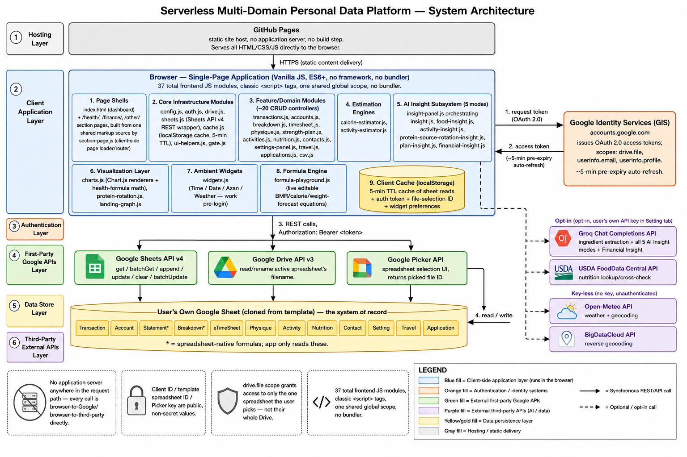

# Ledger

A private, serverless dashboard for health, money, work, travel, applications, LeetCode practice and contacts, backed by a Google Sheet you own.

## At a glance

- **Your data, your sheet:** every record lives in your own copy of the template Google Sheet; there is no backend or database.
- **Narrow access:** Google's `drive.file` scope lets the app touch only the sheet you copied or picked.
- **No build step:** plain HTML, CSS and JavaScript served by GitHub Pages.
- **Opt-in services:** AI, USDA and stock data run only once you add their API keys.

## Sections

| Section | What it holds |
|---|---|
| **Health** | Daily log, ingredient catalogue, activity plan, charts, plan tuning and AI insight |
| **Finance** | Transactions, accounts, spending breakdown, watch list, market analysis and portfolio |
| **Track** | LeetCode progress, work time, car service, travel, applications and contacts |
| **Settings** | Every preference and API key, from the account menu |

## Quick start

1. **Copy the template sheet and create a Google OAuth client:** see [Getting started](docs/development/getting-started.md).
2. **Fill in `assets/script/config.js`:** client ID, template sheet ID and Picker key.
3. **Run locally:** `python scripts/serve.py 8000`, then open `http://localhost:8000`.
4. **Publish:** push to GitHub and turn on Pages: see [Deployment](docs/development/deployment.md).

## Documentation

- **[Docs index](docs/README.md):** every page, grouped as below.
- **[Guide](docs/README.md#guide):** what each page shows and does.
- **[Reference](docs/README.md#reference):** sheet tabs, health formulas, conventions, design system, site map.
- **[Development](docs/README.md#development):** setup, configuration, architecture, data access, security, versioning, deployment.
- **[Changelog](docs/changelog.md):** every commit with its version.

## License

All rights reserved. See [LICENSE](LICENSE).
