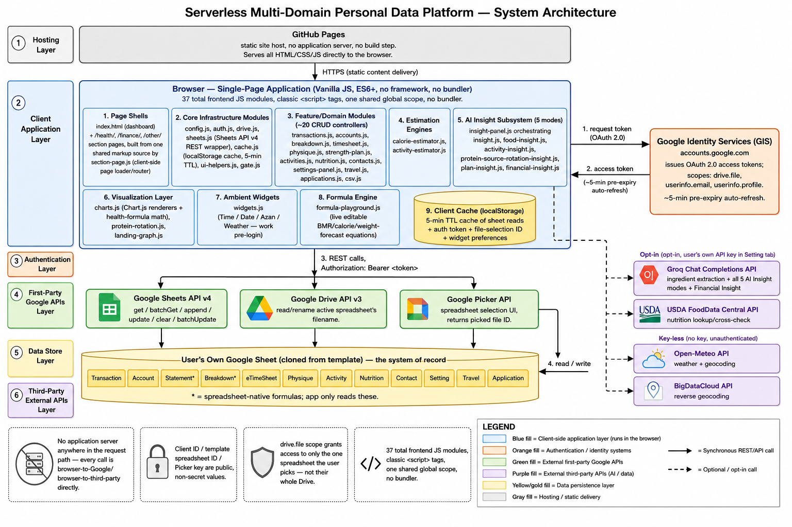

# Ledger

A private, serverless personal life dashboard — health, finances, time tracking, travel, applications, LeetCode practice and contacts in one place.

- Reads and writes **directly to a Google Sheet you own**. No backend, no database, no third-party data store.
- Single-page vanilla-JS app on GitHub Pages; no build step.
- Each user copies the template sheet; the app only touches that copy, via Drive's per-file `drive.file` scope.

## Documentation

### Product

- [Features](docs/features/README.md) — every section and page, one file each.
  - [Finance — Watch List](docs/features/finance-watchlist.md) — the stocks you follow, their latest moves and price alerts.
  - [Finance — Market](docs/features/finance-market.md) — one stock's chart 1d to All, rule-based verdict, risk, news and an AI read.
  - [Finance — Portfolio](docs/features/finance-portfolio.md) — trade log at average cost, gain/loss in CAD.
  - [Health — Chart](docs/features/health-chart.md) — every Health chart on one range, a Daily Progress heatmap of each day's Calorie Balance, and five desired grades (Beat, Met, Near, Short of, Missed desired) shared by every chart, shaded on a continuous colour blend; Body Mass's Calorie Trend starts at the mean of its first L_p days.
  - [Track — LeetCode](docs/features/track.md#track) — the NeetCode 250 roadmap ticked off from your logged solves, a Progress card with video hours watched and a finish date at last week's pace, a past-year heatmap (16 weeks on a phone), NeetCode's roadmap graph, category tables with each problem's video Duration and 🎥 YouTube / 📄 NeetCode / 🔗 LeetCode buttons, and a red badge of the solves today owes against the last 7 days' average.
- [Design System](docs/design-system.md) — colours, type sizes, spacing, tables, buttons.
- [Naming & Display Conventions](docs/conventions.md) — wording, BMR names, units, dates, hover format.

### Engineering

- [Architecture](docs/architecture.md) — system diagram, request flow, module map, data flow.
- [Data Model](docs/data-model.md) — every sheet tab, column by column.
- [Health Formula Reference](docs/health-formulas.md) — every Health formula and where it lives.
- [Tech Stack](docs/tech-stack.md) — every layer and library.
- [Project Structure](docs/project-structure.md) — the file tree, one line per module.
- [Caching Strategy](docs/caching.md) — no sheet caching (stock prices excepted), batched reads, quota handling.

### Operations

- [Getting Started](docs/getting-started.md) — deploy your own copy.
- [Deployment](docs/deployment.md) — GitHub Pages and the OAuth origin.
- [Versioning](docs/versioning.md) — automatic MAJOR.MINOR.PATCH from commit messages (`feat:` minor, `fix:`/other patch, `feat!:` major).
- [Changelog](docs/changelog.md) — every commit with its version and a summary of the changes.
- [Configuration Reference](docs/configuration.md) — sheet ranges and localStorage entries.
- [Stock Data Setup](docs/stock-data-setup.md) — to do: the three free API keys for Watch List, Market and Portfolio.
- [Security & Privacy](docs/security.md) — scopes, secrets, what each external call sends.

## License

All rights reserved. See [LICENSE](LICENSE).
