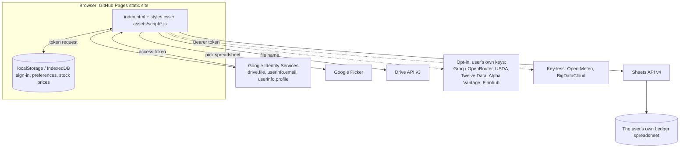
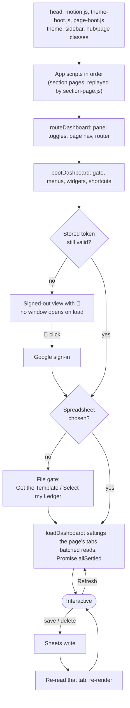

# Architecture

[Docs](../README.md) › Development

How Ledger is put together: a static site that talks to Google's APIs straight from the browser, one page shell, and many plain scripts.

## At a glance

- **No server:** GitHub Pages serves static files; the browser calls Google Sheets with the user's own OAuth token.
- **One markup file:** `index.html` holds every block; each section page fetches it and shows one group.
- **No build step:** vanilla ES6+ in classic `<script>` tags sharing one global scope, loaded in a fixed order.
- **Sheets is the database:** each user's own copy of the template spreadsheet, reached through `drive.file`.
- **Optional services:** AI, USDA and stock data run only with the user's own keys from the `Setting` tab.

## Tech stack

| Layer | Choice |
|---|---|
| Frontend | HTML5, CSS3, vanilla JavaScript (ES6+); no framework, no bundler |
| Charts | [Chart.js](https://www.chartjs.org/), [chartjs-chart-geo](https://github.com/sgratzl/chartjs-chart-geo) with [world-atlas](https://github.com/topojson/world-atlas) for the world map |
| Chart export | [html2canvas-pro](https://github.com/yorickshan/html2canvas-pro), loaded on the first 📤 |
| Sign-in | [Google Identity Services](https://developers.google.com/identity), OAuth 2.0 token client |
| File choice | [Google Picker API](https://developers.google.com/drive/picker) |
| Data | Google Sheets API v4; Google Drive API v3 for the file name |
| Widgets | `navigator.geolocation`, `Intl`, [Open-Meteo](https://open-meteo.com/), [BigDataCloud](https://www.bigdatacloud.com/) |
| AI and nutrition | [Groq](https://groq.com/) or [OpenRouter](https://openrouter.ai/) chat completions; [USDA FoodData Central](https://fdc.nal.usda.gov/) |
| Stock data | [Twelve Data](https://twelvedata.com), [Alpha Vantage](https://www.alphavantage.co), [Finnhub](https://finnhub.io) |
| Hosting | GitHub Pages |

## System diagram

- **Every Sheets call:** carries the user's token, which `drive.file` limits to files the app created or the user picked.
- **Public values:** `config.js` is visible to everyone and holds no secrets (see [Security](security.md)).

## Section pages

- **Addresses:** `/health/`, `/finance/`, `/track/`, `/other/`, and blocks or buttons below them such as `/health/physique/log/`.
- **Stubs:** each address is a folder with a small `index.html` (CSP, `<base>`, title, `theme-boot.js`, `motion.js`, `section-page.js`); only `<base>` and `<title>` differ.
- **Loader:** `section-page.js` fetches `index.html`, replays its head, body and scripts into the stub, and hides every group but the one named.
- **Sections come from the nav:** the first path segment is matched against `index.html`'s `<nav>` links, so a new group needs a nav link, a `<section>` and stubs.
- **Hidden, not removed:** the other groups stay in the DOM, so every renderer finds its elements.
- **Routing:** `router.js` reads the rest of the path from `ledgerSectionPage.route`, opens that block or form, and keeps the address in step.
- **Row addresses:** `/health/nutrition/<name>/`, `/health/physique/<date>/` and similar have no folder; GitHub Pages serves `404.html`, which sets `<base>` and loads the loader.
- **Slugs:** lowercase with hyphens ("Chicken Breast" → `chicken-breast`), set by `data-route` on panels and buttons.
- **Stacked forms:** each form is a history step, so Back closes the innermost one.
- **Sitemap:** `scripts/build_sitemap.py` lists the home page and every stub folder; rerun it after adding a stub; row addresses stay out.
- **Relative URLs:** the markup and loader use relative URLs, and section pages set canonical and `og:url` from `location`.

## Boot and data flow

- **Before first paint:** `theme-boot.js` (every page) sets theme and sidebar; `page-boot.js` (`index.html`) sets Widgets/Bulbs visibility and hub/page classes, and removes any old service worker.
- **Start-up hooks:** on a section page `app.js` registers `routeDashboard` with `onRoute()` and `bootDashboard` with `onBoot()`; on the home page it runs on `DOMContentLoaded`.
- **Route first:** `html[data-routing]` hides content until the route step runs, so a reload never shows the whole section before the page.
- **Widgets:** start in `bootDashboard` regardless of sign-in; Settings later override defaults but not a manual pick.

## Sign-in

- **On load:** a stored, unexpired token is used; otherwise the page shows signed-out with the 🔑 icon and opens no Google window.
- **Expiry:** tokens last about an hour; at expiry the app goes signed-out quietly, with no background renewal.
- **Across tabs:** signing in on one tab signs in the others through the `storage` event.
- **Before a write:** a capture-phase listener (`setupAuthGatedActions`, `app.js`) awaits a token before any button that opens a form or edits the sheet.
- **Token check:** `ensureAccessToken()` returns a token with over 2 minutes left at once; otherwise it opens sign-in, but only inside a user click.
- **Read-only buttons:** marked `data-no-auth` (e.g. LeetCode's 🎥📄🔗) skip the gate.
- **At save:** a 401 renews the token once and re-sends the same request, so a long-open form still saves.
- **Sign-out:** revokes the token and clears the token, consent flag, chosen spreadsheet and stock cache.

## What each page loads

Every page reads the `Setting` tab first. Reads are batched (see [Data access](data-access.md)).

| Page | Tabs read |
|---|---|
| Home | Activity, Physique, Statement, Account, Breakdown, Transaction, eTimeSheet, LeetCode, Watchlist, Analysis (glance cards and tile badges) |
| Health | Activity, Physique, Nutrition |
| Finance | Statement, Account, Breakdown, Transaction, Watchlist, Analysis, Trade |
| Track | Transaction (Car Service), eTimeSheet, Travel, Application, LeetCode, Contact |
| Other | The Settings block |

- **Charts:** built lazily by `upsertChart` (`charts-base.js`) once a chart box scrolls into view.
- **Insight:** nothing is computed on load; a mode click builds its preview, and **Send to AI** sends what is on screen.
- **Refresh:** re-reads every range, the tab list included.

## Module map

Scripts load in this order; [Project structure](project-structure.md) has one line per file.

| Layer | Files |
|---|---|
| Head (before paint) | `motion.js`, `theme-boot.js`, `page-boot.js` |
| External | Google sign-in and Picker (async), Chart.js and chartjs-chart-geo (deferred) |
| Core | `config.js`, `auth.js`, `drive.js`, `sheets.js`, `cache.js`, `ui-helpers.js`, `ai.js` |
| Nutrition services | `health-nutrition-usda.js`, `health-nutrient-desired.js`, `health-nutrition.js`, `health-physique-estimator.js` |
| Widgets and chart base | `ledger-widgets.js`, `charts-base.js`, `health-math.js` |
| Charts | `health-chart.js` and `health-chart-*.js`, `finance-chart.js`, `track-work-time-chart.js`, `track-travel-chart.js` |
| Stock data | `finance-market-data.js`, `finance-market-math.js`, `finance-portfolio-math.js`, `finance-market-chart.js` |
| Blocks | `finance-*`, `track-*`, `health-activity*`, `health-physique*`, `other-*`, `csv.js` |
| Insight and Tune | `health-insight-*.js`, `health-insight.js`, `health-tune-*.js`, `health-tune.js`, rotation charts, `finance-insight.js` |
| Shell | `gate.js`, `version.js`, `app.js`, `router.js`, `page-nav.js` |
| Section stubs only | `section-page.js` |

- **Order matters:** a file may use globals from any file above it at load time, and from any file once boot runs.
- **Pure math:** `health-math.js`, `finance-market-math.js` and `finance-portfolio-math.js` have no DOM code; the last two have Node tests in `scripts/`.
- **Animation:** only `motion.js` animates, behind `window.Motion`.

## Related

- [Project structure](project-structure.md): every file, one line each.
- [Data access](data-access.md): Sheets read/write rules, batching, quota, caching.
- [Security](security.md): scopes, secrets, what leaves the browser, CSP, pinned libraries.
- [Configuration](configuration.md): `CONFIG`, `Setting` keys and browser storage.
- [Site map](../reference/site-map.md): every address and its breadcrumb.
- [Navigation](../guide/navigation.md): hubs, sidebar, tab bar, addresses, forms, motion, shortcuts, display switches.
